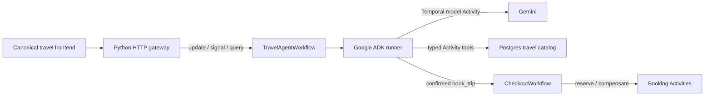

# Canonical Google ADK demo on Temporal

This is the Google ADK counterpart to
[`temporal-sa/canonical-ai-demo`](https://github.com/temporal-sa/canonical-ai-demo).
It keeps the travel-planner frontend and its gateway contract, but Google ADK
owns the agent/model/tool loop. Temporal makes that loop durable.

The repository showcases the same agent in two Temporal SDKs:

| Worker | Temporal + ADK integration | Run |
|---|---|---|
| [Python](python/README.md) | `temporalio.contrib.google_adk_agents` | `make up` |
| [Go](go/README.md) | `go.temporal.io/sdk/contrib/googleadk` | `cd go && make up` |

Only one worker should poll `travel-agent` at a time. The Python worker is the
default deployment; the Go worker is equally runnable and has its own image in
[`docker/worker-go.Dockerfile`](docker/worker-go.Dockerfile).

## What changed from the canonical demo

- The frontend, seeded travel data, HTTP endpoints, workflow/update/signal/query
  names, itinerary view, research progress, approvals, and checkout experience
  are retained.
- The hand-written Temporal-native agent loop is replaced by Google ADK's agent
  runner in both languages.
- ADK model calls become retryable Temporal Activities through `TemporalModel`
  (Python) or `googleadk.NewModel` (Go).
- Typed Temporal Activities are exposed as ADK tools through `activity_tool`
  (Python) or `ActivityAsTool` (Go).
- ADK tool confirmation is bridged to the existing `confirm_action` signal, so
  an approval can survive worker restarts.
- `research_destination` still demonstrates a durable plan → parallel Google
  Search → write pipeline, and `book_trip` still starts the compensating child
  `CheckoutWorkflow`.

The complete language-neutral wire contract is in [`CONTRACT.md`](CONTRACT.md).

## Architecture



The ADK runner and session live inside workflow execution. On replay, ADK runs
deterministically while completed model/tool Activity results are read from
Temporal history instead of being called again.

## Quick start

Prerequisites: Docker, the [Temporal CLI](https://docs.temporal.io/cli),
[`uv`](https://docs.astral.sh/uv/), and Go 1.25+ for the Go worker.

```bash
cp .env.example .env
# add GOOGLE_API_KEY to .env
make up
```

Open:

- travel UI: <http://localhost:5173>
- Temporal UI: <http://localhost:8233>
- gateway: <http://localhost:8000>

Switch to Go with a fresh conversation:

```bash
make kill-worker
cd go && make worker
```

Histories are language-specific, so do not switch SDKs for an already-started
conversation.

## Demo paths

- Ask for events in Auckland in March, find a flight, then ask for an invoice.
  ADK requests confirmation before `create_invoice` runs.
- Ask for a deep Tokyo research guide. The workflow fans out separately
  retryable Google Search Activities and publishes progress to the retained UI.
- Add a flight and hotel, then book. After approval, the child workflow books
  the flight, injects a hotel failure by default, and compensates the flight.
- Run `make kill-worker` during a turn and `make worker` to show replay and
  recovery. Run `make kill-db` / `make db` to show Activity retries.

## Verification

```bash
cd python && uv run pytest -q
cd ../go && go test ./...
```

The deployable images are in [`docker/`](docker/). The Temporal demo-cloud
registration is maintained in
[`temporal-sa/tmprl-demo-cloud-registry`](https://github.com/temporal-sa/tmprl-demo-cloud-registry).
